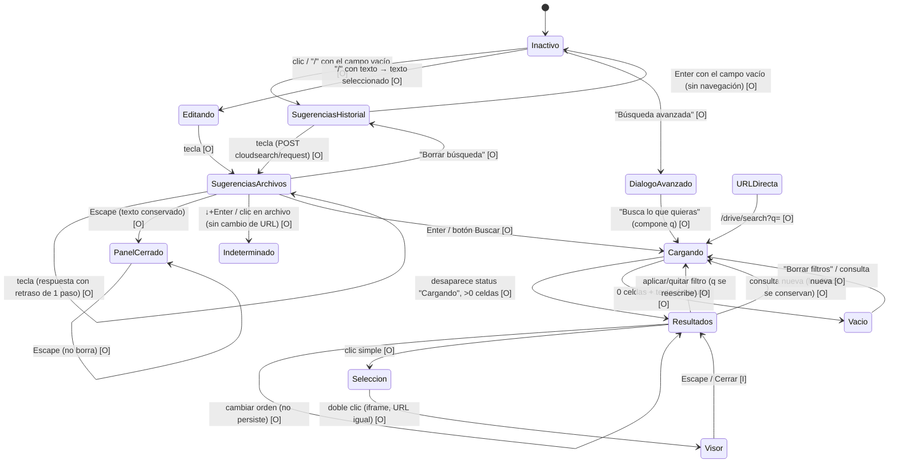

# Funcionalidad del superbuscador de Google Drive: investigación funcional con REA

| Campo | Valor |
| --- | --- |
| Tipo de documento | Referencia funcional de investigación externa (docs-only) |
| Autoridad | **No rectora.** No reemplaza `docs/SOURCES_OF_TRUTH.md`, `docs/audit/README.md` ni la fuente vigente del dashboard (`docs/audit/AUDITORIA_GLOBAL_DASHBOARD_VETNEB_VS_DRIVE.md`) |
| Fecha de la investigación | 2026-11-08 |
| Objeto observado | Superbuscador de Google Drive web (interfaz en español), en una cuenta real en desuso, con autorización expresa de su titular |
| Herramienta | REA 6.5.0 (servidor MCP `rea`) usado desde Claude Code, perfil aislado de laboratorio |
| Laboratorio de origen | `REA-LAB/results/drive-search-functional` (fuera de este repositorio) |
| Experimentos | 52 (E01–E52) |
| Resultado | OBSERVADO 41 · INFERIDO 2 · DOCUMENTADO 2 · NO RESUELTO 5 · BLOCKED 2 |
| Privacidad | Evidencia saneada. Sin nombres de archivos, contactos, correos, consultas ajenas, enlaces privados, cookies ni tokens. Los términos de búsqueda derivados de la cuenta se sustituyen por alias `TOK-*` / `ARCHIVO-A` |
| Alcance del cambio | Solo este archivo. Sin cambios de frontend, backend, tests, configuración ni workflows |

---

## 1. Resumen ejecutivo

Se investigó de forma experimental y reproducible el comportamiento **funcional** del buscador de Google Drive: sugerencias, autocompletado, historial, gramática de consultas, filtros, persistencia, relevancia, carga incremental, navegación y teclado. No se recogieron CSS, dimensiones, colores, tipografías, geometría ni animaciones.

Se ejecutaron 52 experimentos mediante `capture_browser_scenario` de REA, conectado por CDP a un Chrome de laboratorio aislado. Resultado: **41 observados, 2 inferidos, 2 documentados, 5 no resueltos y 2 bloqueados.**

Hallazgos principales (todos OBSERVADOS salvo indicación):

1. **Los filtros son operadores dentro de `q`.** Cualquier filtro, incluidos los del diálogo "Búsqueda avanzada", se serializa como operador en el único parámetro `q` de `/drive/search`. Por ejemplo, `type:pdf`, `after:2025-01-01 before:2025-12-31` o `title:X`. Los chips de filtro son una vista de esos operadores, y la URL reproduce la búsqueda completa.
2. **Los filtros persisten al modificar el texto.** Elegir otro tipo **sustituye** al anterior en lugar de sumarse.
3. **Las sugerencias tienen dos modos.** Con el campo vacío muestran el historial (de más reciente a más antigua). Al escribir muestran hasta 5 archivos. Toleran errores de escritura y respetan un `type:` escrito en el campo.
4. **Gramática de consultas:**
   - Funcionan el AND implícito, `OR`, las comillas (frase exacta), el prefijo y la insensibilidad a mayúsculas.
   - `-término` **no excluye de forma fiable**.
   - Un operador desconocido (`foo:bar`) se trata como término literal obligatorio y produce 0 resultados.
5. **Resultados:** se cargan en bloques de **20**. Ordenar por "Fecha de modificación" no viaja en la URL y **no persiste** en la búsqueda siguiente.
6. **Teclado:** `/` enfoca el campo **seleccionando** su texto. El primer Escape cierra el panel sin borrar la consulta. Enter con el campo vacío no navega.
7. **Limitaciones de REA:**
   - Con `service_workers: "block"` (el valor por defecto), REA falla contra Drive con `InvalidStateError`; con `service_workers: "allow"` funciona.
   - El visor de archivos está en un iframe que la captura del marco principal no cubre.
   - El snapshot de accesibilidad no expone el foco ni la opción activa, lo que impide verificar parte de la navegación por teclado.

---

## 2. Objetivo y alcance

### 2.1 Objetivo
Comprender y documentar el comportamiento funcional observable del superbuscador de Google Drive como referencia externa para el diseño del buscador global del dashboard VETNEB.

### 2.2 Incluido
Autocompletado y sugerencias, historial de consultas, búsqueda por nombre y contenido, coincidencias parciales y exactas, filtros individuales y combinados, operadores, ordenamiento y relevancia, carga incremental, navegación por teclado, apertura y retorno a resultados, persistencia de consultas y filtros, estados vacíos y errores, y funciones inteligentes visibles.

### 2.3 Excluido
- CSS, dimensiones, tipografías, colores, bordes, sombras, espaciados, breakpoints, geometría y animaciones estéticas.
- Lectura o exportación de cookies, credenciales, documentos o contenido de otras cuentas.
- Crear, modificar, mover, compartir, descargar o borrar documentos.
- Borrar masivamente el historial.
- Cambiar preferencias persistentes (por ejemplo, la vista Lista/Cuadrícula).
- Invocar Gemini.
- Cualquier cambio funcional en VETNEB.

### 2.4 Naturaleza del documento
Este documento es una **referencia funcional de investigación externa**. No es una fuente rectora de implementación, no modifica el índice de auditorías y no altera prioridades ni criterios de aceptación del rediseño del dashboard.

---

## 3. Entorno de investigación REA

| Elemento | Valor |
| --- | --- |
| Cliente | Claude Code 2.1.319 con perfil aislado (`CLAUDE_CONFIG_DIR` del laboratorio) |
| Servidor MCP | `rea` (REA 6.5.0, stdio), registrado solo en el perfil aislado |
| Navegador | Chrome 156.0.8078.80, CDP 1.3, en `127.0.0.1:9222` |
| Perfil del navegador | Perfil dedicado del laboratorio. El socket del puerto 9222 se verificó a nivel de sistema operativo como perteneciente a ese proceso. El navegador personal del operador no tenía depuración remota |
| Target | Una única pestaña de Drive, localizada con `list_browser_targets` |
| Herramienta de ejecución | `capture_browser_scenario` en modo `connect` (proceso externo; REA solo se desconecta al terminar) |
| Entorno emulado | `locale=es-ES`, `timezone=America/Argentina/Buenos_Aires`, `reduced_motion=reduce`, **`service_workers=allow`** |
| Capturas habilitadas | URL, árbol de accesibilidad, historial de navegación y metadatos de red (método, ruta, nombres de parámetros) |
| Capturas deshabilitadas | Cuerpos de request/response, valores de cabeceras, cookies, almacenamiento, capturas de pantalla y DOM completo |
| Herramientas auxiliares | `observe_web_session` (observación pasiva de navegación) |

---

## 4. Metodología experimental

### 4.1 Ciclo por experimento
Cada caso siguió la secuencia **estado inicial → interacción → resultado → verificación → restauración**:

1. **Estado inicial:** cada escenario parte de una navegación explícita (`start_url`) a `/drive/my-drive`, `/drive/home` o `/drive/search?q=…`.
2. **Interacción:** acciones declarativas de REA: `click` (simple o doble), `fill`, `press`, `goto` y `wait_for_timeout`. Cada acción interactiva lleva `timeout_ms`.
3. **Resultado:** captura de URL y accesibilidad después de cada paso.
4. **Verificación:** extractores locales calculan los valores del apartado 4.2 sin imprimir nombres.
5. **Restauración:** ordenación y filtros vuelven a su valor por defecto. Al final, la pestaña se devolvió a `/drive/home`.

### 4.2 Saneamiento
Las respuestas de REA contienen nombres reales de la cuenta. Nunca se copiaron a los informes: se analizaron con extractores locales que solo emiten:

- roles y nombres accesibles de la **interfaz** (vocabulario de la propia UI);
- conteos de celdas y sugerencias;
- la relación de cada sugerencia con lo escrito (prefijo del nombre, prefijo de palabra, infijo, sin coincidencia);
- tipos de archivo por vocabulario de interfaz (PDF, Imagen, Carpeta…);
- hashes del **conjunto** y del **orden** de los resultados, para comparar consultas sin revelar su contenido;
- ruta de la URL, nombres de parámetros y valor de `q` solo para consultas construidas por el investigador.

### 4.3 Alias de datos
| Alias | Significado |
| --- | --- |
| `TOK-A` | Prefijo genérico de nombres de capturas de pantalla (10 caracteres) |
| `TOK-A-typo` | `TOK-A` con una letra omitida |
| `TOK-A-pre` | Primeros 8 caracteres de `TOK-A` |
| `TOK-A-inf` | `TOK-A` sin su primera letra (infijo) |
| `TOK-B` | Prefijo genérico de nombres de fotos de cámara (3 caracteres) |
| `TOK-C` | Término técnico presente en el nombre de 1 PDF y en el contenido de otro |
| `TOK-D` | Término de aplicación presente en nombres de archivo |
| `TOK-E` | Año de 4 dígitos |
| `ARCHIVO-A` | Imagen cuyo nombre es `TOK-A` más un sufijo numérico corto |
| `NOEXISTE` | Cadena sin sentido construida para el estado vacío |

### 4.4 Clasificación
| Estado | Criterio |
| --- | --- |
| **OBSERVADO** | Prueba reproducible ejecutada con resultado medido |
| **INFERIDO** | Conclusión deducida de resultados observados, sin medición directa |
| **DOCUMENTADO** | Texto o estructura de la propia interfaz capturado sin ejercitar el comportamiento |
| **NO RESUELTO** | Ejecutado sin resultado concluyente |
| **BLOCKED** | No ejecutable dentro de las restricciones o por falta de capacidad de la herramienta |

Límite común: todos los conteos se refieren a las celdas **cargadas** en la cuadrícula (bloques de 20, E34), no al total del índice.

---

## 5. Inventario funcional completo

### 5.1 Puntos de entrada
| Elemento | Rol / nombre accesible | Estado |
| --- | --- | --- |
| Campo de búsqueda | `search` > `textbox "Buscar en Drive"` | OBSERVADO |
| Botón de búsqueda | `button "Buscar en Google Drive"` | OBSERVADO |
| Borrar | `button "Borrar búsqueda"` (solo con texto) | OBSERVADO |
| Búsqueda avanzada | `button "Búsqueda avanzada"` → `dialog "Búsqueda avanzada"` modal | OBSERVADO |
| Atajo de teclado | `/` (enfoca y selecciona el texto) | OBSERVADO |
| URL directa | `/drive/search?q=<consulta con operadores>` | OBSERVADO |

### 5.2 Panel de sugerencias (con el campo enfocado)
| Elemento | Detalle | Estado |
| --- | --- | --- |
| Lista | `listbox "Suggestions"` (nombre en inglés dentro de una interfaz en español) | OBSERVADO |
| Historial | `option "Search for \"<consulta>\""`, de más reciente a más antigua, con el campo vacío | OBSERVADO |
| Archivos | `option "Open <tipo> \"<nombre><fecha><propietario>\""`, máximo 5 | OBSERVADO |
| Texto fantasma | `textbox [disabled]` secundario con la completación propuesta | OBSERVADO |
| Filtros del panel | Texto "No se han aplicado filtros" + `toolbar "Filtros"`: Ubicación, Tipo, Personas, Modificado | OBSERVADO |
| Acciones | "Opción de búsqueda avanzada"; "Todos los resultados" (deshabilitado sin texto) | OBSERVADO |

### 5.3 Página de resultados
| Elemento | Detalle | Estado |
| --- | --- | --- |
| Encabezado | `heading "Resultados de búsqueda"` [level=1] | OBSERVADO |
| Contador de filtros | "No se han aplicado filtros" / "N filtro(s) aplicado(s)" | OBSERVADO |
| Barra de filtros | Tipo, Personas, Modificado, Fuente, Ubicación, "Solo título" (conmutador), Tareas, "Borrar filtros" | OBSERVADO |
| Chip aplicado | `button "Filtro aplicado <valor>"` + `button "Quitar"` | OBSERVADO |
| Orden | `button "Ordenar por:"` → "Más relevantes" / "Fecha de modificación" | OBSERVADO |
| Cuadrícula | `grid` > `gridcell "<nombre> <tipo> Más información (Alt + →)"`, en bloques de 20 | OBSERVADO |
| Carga | `status "Cargando"` | OBSERVADO |
| Estado vacío | Texto de ayuda (sección 17) | OBSERVADO |
| Selección | Clic simple → barra "1 seleccionado" con acciones | OBSERVADO |
| Visor | Doble clic → visor en iframe superpuesto; la URL no cambia | OBSERVADO (parcial) |

### 5.4 Motor de consulta
| Capacidad | Estado |
| --- | --- |
| Coincidencia por nombre, por prefijo, sin distinguir mayúsculas | OBSERVADO |
| Frase exacta con comillas | OBSERVADO |
| AND implícito, OR explícito | OBSERVADO |
| Exclusión con `-` | OBSERVADO como **no fiable** |
| Búsqueda en el contenido (texto completo) | INFERIDO (E12) |
| Tolerancia a errores de escritura (sugerencias y resultados) | OBSERVADO |
| Coincidencias que no están en el nombre ni proceden de una corrección textual (imágenes) | INFERIDO (E51) |
| Lenguaje natural → filtros | OBSERVADO como **no** traducido a chips |
| Operador desconocido → término literal obligatorio | OBSERVADO |

### 5.5 Funciones inteligentes visibles
| Elemento | Estado |
| --- | --- |
| "Pregunta a Gemini" (cabecera) | DOCUMENTADO (no invocado) |
| "Preguntar a Gemini" en la barra de selección (deshabilitado para tipos no admitidos) | DOCUMENTADO |
| Tipos "Gems de Gemini" y "Conversaciones con Gemini" en los menús de tipo | DOCUMENTADO |

### 5.6 Comunicación con el servidor (solo metadatos)
| Petición | Momento | Estado |
| --- | --- | --- |
| `GET /cloudsearch/init` | Carga de la página | OBSERVADO |
| `POST /cloudsearch/request` | Al enfocar el campo, en cada pulsación y al cargar resultados | OBSERVADO |
| Datos de la cuadrícula de resultados | No visibles como petición de la página | NO RESUELTO (sección 21, G3) |
| `POST /drive/jserror` | Durante la carga de resultados de una ejecución (R04) | OBSERVADO (el cliente reporta un error JS) |

---

## 6. Activación y estados del buscador

| Disparador | Efecto | Estado | Exp. |
| --- | --- | --- | --- |
| Clic en el campo vacío | Abre `listbox "Suggestions"` con el historial y la barra de filtros rápidos; dispara `POST /cloudsearch/request` | OBSERVADO | E01 |
| `/` con la página enfocada | Enfoca el campo y **selecciona** el texto existente; la tecla siguiente lo reemplaza y abre las sugerencias | OBSERVADO | E36 |
| Escribir | Pasa de las sugerencias de historial a las de archivos; aparece "Borrar búsqueda"; se habilita "Todos los resultados" | OBSERVADO | E02 |
| Enter o "Buscar en Google Drive" | Navega a `/drive/search?q=<consulta>` | OBSERVADO | E10 |
| Enter con el campo vacío | No navega | OBSERVADO | E46 |
| "Búsqueda avanzada" | Abre un diálogo modal (el resto de la página queda inerte) | OBSERVADO | E26 |
| Navegación directa por URL | Reconstruye consulta, chips y resultados | OBSERVADO | E42 |

Durante la carga, la página anuncia `status "Cargando"`. Al terminar, muestra celdas de resultado o el texto de estado vacío.

---

## 7. Sugerencias y autocompletado

### 7.1 Petición por pulsación
- **Peticiones:** cada foco y cada pulsación envían un `POST /cloudsearch/request`. Con pulsaciones separadas 1,5 s se observó una petición por tecla, sin agrupar. **El debounce real no se midió** (E06).
- **Latencia visible:** justo después de cada tecla, la lista muestra todavía la respuesta anterior y se actualiza cuando llega la nueva (retraso de un paso).

### 7.2 Contenido según el estado del campo
| Campo | Contenido | Estado | Exp. |
| --- | --- | --- | --- |
| Vacío | Historial `Search for "<q>"`, de más reciente a más antigua (2–5 entradas observadas) | OBSERVADO | E01, E07 |
| 1–2 caracteres | 5 archivos (PDF/vídeo) **sin** prefijo coincidente en el nombre, con fecha y propietario en la etiqueta | OBSERVADO | E02 |
| ≥ 3 caracteres | 5 de 5 archivos con prefijo coincidente en el nombre (imágenes, sin fecha ni propietario en la etiqueta) | OBSERVADO | E02 |
| Con error de escritura (`TOK-A-typo`) | 5 de 5 archivos del término correcto: **tolerancia a errores observada** | OBSERVADO | E03 |
| Infijo (`TOK-A-inf`) | 5 de 5 sugerencias contienen el infijo | OBSERVADO | E16 |
| Con un operador escrito (`type:pdf`) | 5 de 5 sugerencias son PDF: el operador se interpreta en el autocompletado. No hay sugerencias de operadores como tales | OBSERVADO | E04 |
| Tras "Borrar búsqueda" | Vuelve el historial | OBSERVADO | E09 |

Hipótesis (INFERIDO, no verificado): que con 1–2 caracteres las sugerencias no coincidan por nombre se explicaría por un modelo de recencia o relevancia personal.

### 7.3 Autocompletado en línea
- Un `textbox [disabled]` secundario contiene la completación propuesta (texto fantasma). OBSERVADO
  - Con un carácter, contenía una cadena de 25 caracteres que extendía lo escrito.
  - Cuando la consulta coincidía con una entrada del historial, contenía esa entrada.
  - Con 2 o más caracteres sin entrada de historial coincidente, estaba vacío.
- Cómo se acepta la completación (Tab o →): **NO RESUELTO**.

### 7.4 Interacción con las sugerencias
| Acción | Resultado | Estado | Exp. |
| --- | --- | --- | --- |
| ↑ / ↓ | No cambian el valor del campo; la opción activa no se expone en la accesibilidad | OBSERVADO (sin cambio) / NO RESUELTO (resaltado) | E37 |
| ↓ + Enter | Cierra el panel; no cambia la URL ni abre pestaña | NO RESUELTO | E05 |
| Clic en una sugerencia de archivo | Cierra el panel; la URL no cambia; aparece un botón "Cerrar" un instante (el visor no es observable) | NO RESUELTO | E05 |
| Escape (1.º) | Cierra el panel y conserva el texto | OBSERVADO | E38 |
| Escape (2.º) | No borra el texto | OBSERVADO | E38 |

---

## 8. Historial de búsqueda

| Aspecto | Resultado | Estado | Exp. |
| --- | --- | --- | --- |
| Registro | Una búsqueda enviada con Enter aparece **primera** en la lista con el campo vacío | OBSERVADO | E07 |
| Orden | De más reciente a más antigua | OBSERVADO | E07 |
| Crecimiento | 2 → 4 → 5 entradas a lo largo de la sesión | OBSERVADO | E07, E09 |
| Persistencia | La entrada sigue presente en ejecuciones posteriores (cada ejecución recarga la página) | OBSERVADO | E08 |
| Ámbito | Ligado a la cuenta (persiste entre cargas) | INFERIDO | E08 |
| Origen de las entradas | Unas 25 búsquedas por URL directa no aparecieron como entradas nuevas; sí las enviadas desde el campo o el diálogo avanzado | INFERIDO | E07 |
| Borrado individual | Las opciones del historial tienen celdas sin nombre accesible; no se expone ningún botón para eliminar. Sin ese control no se ejecutó (y el borrado masivo no estaba autorizado) | NO RESUELTO | E09 |

---

## 9. Gramática de consultas y operadores

**Regla central (OBSERVADO, E19–E28, E42–E44):** todo filtro se serializa como operador dentro de `q`. El campo muestra el texto libre (y `title:`); los operadores reconocidos (`type:`, `owner:`, fechas, `is:starred`) se convierten en chips.

| Operador | Ejemplo | Chip / efecto | Estado | Exp. |
| --- | --- | --- | --- | --- |
| (texto) | `X Y` | AND implícito | OBSERVADO | E18 |
| `OR` | `X OR Y` | Unión | OBSERVADO | E31 |
| `"…"` | `"frase"` | Coincidencia exacta | OBSERVADO | E17 |
| `-` | `X -Y` | **No excluye de forma fiable** | OBSERVADO | E30 |
| `type:` | `type:pdf`, `type:image` | Chip "PDFs" / "Fotos e imágenes" | OBSERVADO | E27, E19 |
| `owner:me` | `owner:me` | Chip "Propiedad de <titular>" | OBSERVADO | E23 |
| `title:` | `title:X` | Conmutador "Solo título" [pressed] + `status "Filtro aplicado Solo título"` | OBSERVADO | E28, E11 |
| `after:` | `after:2023-01-01` | Chip "Después del 1 ene 2023" | OBSERVADO (chip) | E29 |
| `before:` | `before:2022-01-01` | Chip "Antes del 1 ene 2022" | OBSERVADO (chip) | E29 |
| `after:` + `before:` | Rango de un año | Chip "Año pasado"; cuenta como 2 filtros | OBSERVADO | E21 |
| `is:starred` | `is:starred` | Chip "Destacados" | OBSERVADO | E29 |
| Desconocido | `foo:bar X` | Se trata como literal obligatorio → 0 resultados y estado vacío, **sin aviso** | OBSERVADO | E32 |

Detalle de `-` (E30):
- `TOK-A -TOK-D` siguió mostrando las 7 coincidencias con `TOK-D`.
- `TOK-C -TOK-C` redujo los resultados de 2 a 1 y conservó la coincidencia por nombre.
- Que `-` excluya solo las coincidencias por contenido es una **hipótesis no verificada** (brecha P6).

---

## 10. Búsquedas exactas, parciales y múltiples

| Caso | Consulta | Resultado | Estado | Exp. |
| --- | --- | --- | --- | --- |
| Nombre | `TOK-A` + Enter | `/drive/search?q=TOK-A`, 20 de 20 con `TOK-A` en el nombre | OBSERVADO | E10 |
| Mayúsculas | `TOK-A` en mayúsculas | Mismos 20 resultados con `TOK-A` en el nombre | OBSERVADO | E13 |
| Prefijo | `TOK-A-pre` | 20 de 20 con `TOK-A` en el nombre | OBSERVADO | E15 |
| Infijo | `TOK-A-inf` | Resultados: 10 de 20 contienen el infijo; sugerencias: 5 de 5. Infijo frente a corrección ortográfica, sin aclarar | NO RESUELTO | E16 |
| Frase exacta | `"ARCHIVO-A sin extensión"` | Exactamente 1 resultado; el campo conserva las comillas | OBSERVADO | E17 |
| Varias palabras (AND) | `TOK-C NOEXISTE` | 0 resultados con estado vacío | OBSERVADO | E18 |
| OR | `TOK-C OR NOEXISTE` frente a `TOK-C` | Conjunto **y** orden idénticos (comparación por hash) | OBSERVADO | E31 |
| Error de escritura | `TOK-A-typo` | 11 de 20 con `TOK-A` en el nombre; sin texto "¿Quisiste decir…?" | OBSERVADO | E49 |
| Nombre frente a contenido | `TOK-C` con y sin "Solo título" | 2 → 1 → 2 (mismo orden al restaurar) | OBSERVADO | E11 |
| Interpretación | Resultado excluido por "Solo título" | Coincide por contenido o metadatos: existe búsqueda de texto completo | INFERIDO | E12 |
| Tildes | — | Sin corpus controlado con tildes | BLOCKED (datos) | E14 |

---

## 11. Filtros individuales y combinados

### 11.1 Filtros de la página de resultados
| Control | Opciones (texto de interfaz) | Comportamiento | Estado |
| --- | --- | --- | --- |
| Tipo | Carpetas, Documentos, Hojas de cálculo, Presentaciones, Pics, Vids, Markdown, HTML, Gems de Gemini, Conversaciones con Gemini, Formularios, Fotos e imágenes, PDFs, Vídeos, Archivos (zip), Audio, Dibujos, Sites, Accesos directos (19, `menuitemcheckbox`) | Selección **única en la práctica**: otro valor reemplaza al anterior (E20) | OBSERVADO |
| Modificado | Hoy, Últimos 7 días, Últimos 30 días, Este año (2026), Año pasado (2025), Periodo personalizado | "Año pasado" → `after:2025-01-01 before:2025-12-31` | OBSERVADO |
| Personas | 4 contactos (redactados) y "Mostrar elementos que cualquier persona con el enlace pueda abrir" | No aplicado | DOCUMENTADO |
| Fuente | Gmail, Meet | No aplicado | DOCUMENTADO |
| Ubicación | En todo Drive [por defecto], Mi unidad, Compartido conmigo, Destacados, En la papelera | No aplicado | DOCUMENTADO (E22) |
| Solo título | Conmutador | Equivale a `title:` | OBSERVADO |
| Tareas | Pendiente de aprobación, Solicitados por mí, Sugerencias, Comentarios asignados a mí, Revisar y aceptar | No aplicado | DOCUMENTADO |
| Ordenar por | Más relevantes [por defecto], Fecha de modificación | Ver sección 13 | OBSERVADO |

En la barra de filtros del panel de sugerencias aparecen solo Ubicación, Tipo, Personas y Modificado (sin Fuente, Solo título ni Tareas). OBSERVADO (E01).

### 11.2 Secuencia de aplicación sobre `q = TOK-E` (E19, E20, E21, E24, E25)
| Paso | `q` resultante | Chips / contador | Resultado |
| --- | --- | --- | --- |
| Base | `TOK-E` | "No se han aplicado filtros" | 20 imágenes |
| Tipo → PDFs | `TOK-E type:pdf` | "1 filtro aplicado", "PDFs" | 2 de 2 PDF |
| Tipo → Fotos e imágenes | `TOK-E type:image` (**sustituye** a `type:pdf`) | "1 filtro aplicado" | 20 imágenes |
| Modificado → Año pasado | `TOK-E type:image after:2025-01-01 before:2025-12-31` | "3 filtros aplicados" | 0 celdas |
| Quitar (primer chip) | `TOK-E after:2025-01-01 before:2025-12-31` | "2 filtros aplicados" | — |
| Borrar filtros | `TOK-E` | "No se han aplicado filtros" | 20 imágenes |

Combinación por operadores (E24): `type:pdf owner:me` → 2 chips, 20 de 20 PDF. OBSERVADO.

### 11.3 Diálogo "Búsqueda avanzada" (E26)
| Campo | Tipo | Traducción a `q` | Estado |
| --- | --- | --- | --- |
| Tipo | combobox (19 opciones; incluye "Todos", no incluye "HTML") | `type:` | OBSERVADO |
| Propietario | combobox ("Cualquier usuario") | Presumiblemente `owner:` | INFERIDO |
| Contiene las palabras | textbox | Texto libre | OBSERVADO |
| Nombre del elemento | textbox | `title:` | OBSERVADO |
| Ubicación | combobox + casillas En la papelera / Destacados / Cifrado | No ejercitado | DOCUMENTADO |
| Fecha de modificación | combobox ("Cualquier momento") | No ejercitado | DOCUMENTADO |
| Aprobaciones y firmas electrónicas | casillas | No ejercitado | DOCUMENTADO |
| Compartido con | selector de personas | No ejercitado | DOCUMENTADO |
| Seguimientos | combobox | No ejercitado | DOCUMENTADO |
| Acciones | "Restablecer", "Busca lo que quieras" (enviar), "Más información" | Enviar → `/drive/search?q=…` | OBSERVADO |

Ejemplo observado (R10):
- Entrada: "Contiene las palabras = `TOK-D`", "Nombre del elemento = `TOK-A`" y "Tipo = Fotos e imágenes".
- Resultado: `q = "TOK-D title:TOK-A type:image"`. El campo muestra `TOK-D title:TOK-A`, aparece el chip "Fotos e imágenes" con el contador "2 filtros aplicados" y se obtienen 7 resultados.
- Conclusión: el diálogo **no tiene backend propio**; solo compone `q`.

---

## 12. Persistencia de consultas mediante URL

| Regla | Estado | Exp. |
| --- | --- | --- |
| `q` es el único parámetro de `/drive/search` | OBSERVADO | E10 |
| La URL es la fuente de verdad: texto + operadores + filtros | OBSERVADO | E42, E43 |
| Cargar de nuevo la URL restaura consulta, chips y resultados (enlace profundo) | OBSERVADO | E42, E43 |
| Una consulta nueva desde el campo con un chip activo conserva el filtro: `q = "TOK-B type:image"` | OBSERVADO | E44 |
| "Borrar filtros" devuelve `q` al texto original | OBSERVADO | E25 |
| La ordenación **no** se serializa en la URL | OBSERVADO | E35 |

---

## 13. Relevancia y ordenamiento

| Aspecto | Resultado | Estado | Exp. |
| --- | --- | --- | --- |
| Orden por defecto | `menuitemradio "Más relevantes"` [checked] | OBSERVADO | E33 |
| Orden alternativo | "Fecha de modificación"; la etiqueta pasa a "Ordenar por: De nueva a antigua" y cambia el orden (hash distinto) | OBSERVADO | E35 |
| Persistencia | **No** viaja en la URL y **no** persiste: la búsqueda siguiente vuelve a "Más relevantes" | OBSERVADO | E35 |
| Restauración | No fue necesario restaurar ninguna preferencia; se seleccionó "Más relevantes" explícitamente | OBSERVADO | E35 |
| Prioridad del nombre | Las coincidencias por nombre aparecen primero en las consultas por nombre | INFERIDO | E10, E51 |
| Coincidencias que no son por nombre | Con `type:image TOK-A`, solo 9 de 20 tienen `TOK-A` en el nombre; con `TOK-A before:2022`, 0 de 20. Hay coincidencias por algo distinto del nombre (posible contenido o clasificación de imágenes) | INFERIDO | E51 |
| Efecto real de `after:`/`before:` | La cuadrícula no expone fechas; no verificado | NO RESUELTO | E29 |

---

## 14. Presentación y carga incremental de resultados

| Aspecto | Resultado | Estado | Exp. |
| --- | --- | --- | --- |
| Presentación | Cuadrícula; cada resultado es `gridcell "<nombre> <tipo> Más información (Alt + →)"`. En cuadrícula, la fecha no es accesible | OBSERVADO | E10 |
| Carga incremental | Seleccionar el primer resultado y pulsar End ×3: **20 → 40 → 60 → 80** celdas | OBSERVADO | E34 |
| Bloque | 20 resultados por petición de desplazamiento | OBSERVADO | E34 |
| Indicador | `status "Cargando"` durante la carga | OBSERVADO | E45 |
| Agrupación | No se observó agrupación por secciones en los resultados | OBSERVADO | E10, E34 |
| Vista Lista | No ejercitada (preferencia persistente fuera de la autorización) | DOCUMENTADO | — |

---

## 15. Navegación y apertura de documentos

| Acción | Resultado | Estado | Exp. |
| --- | --- | --- | --- |
| Clic simple en un resultado | Selección: barra "1 seleccionado" con acciones (no se pulsó ninguna) | OBSERVADO | E41 |
| Doble clic | Se abre el visor en un **iframe**; aparece la ruta "Ubicación del archivo"; la **URL no cambia** | OBSERVADO | E41 |
| Escape sobre `:focus` del marco principal | Agotó 8 s: el foco está dentro del iframe | OBSERVADO (limitación) | E41 |
| Escape enviado al iframe | Se ejecutó; la URL siguió estable; el cierre del visor no es verificable | NO RESUELTO | E41 |
| Apertura desde una sugerencia de archivo | Sin cambio de URL ni ventana emergente; visor no observable | NO RESUELTO | E05 |
| Retorno a resultados | La URL de resultados se conservó todo el tiempo | OBSERVADO (URL) | E41 |

---

## 16. Interacción mediante teclado

| Tecla | Contexto | Resultado | Estado | Exp. |
| --- | --- | --- | --- | --- |
| `/` | Página | Enfoca el campo **seleccionando** su texto; la siguiente tecla reemplaza la consulta y abre las sugerencias | OBSERVADO | E36 |
| Enter | Campo con texto | Navega a `/drive/search?q=…` | OBSERVADO | E10 |
| Enter | Campo vacío | Sin navegación | OBSERVADO | E46 |
| Escape (1.º) | Panel abierto | Cierra el panel, conserva el texto | OBSERVADO | E38 |
| Escape (2.º) | Panel cerrado | No borra el texto | OBSERVADO | E38 |
| ↑ / ↓ | Sugerencias | El valor del campo no cambia; opción activa no expuesta | OBSERVADO / NO RESUELTO | E37 |
| End | Cuadrícula con selección | Carga el siguiente bloque de 20 | OBSERVADO | E34 |
| Tab | Campo | Orden de foco no verificable con REA | NO RESUELTO | E39 |
| Diálogo de atajos | `button "Combinaciones de teclas"` | Es un enlace de salto visible solo con foco; el clic agotó el tiempo | NO RESUELTO | E39 |

---

## 17. Estados vacíos, errores y limitaciones

| Caso | Resultado | Estado | Exp. |
| --- | --- | --- | --- |
| Sin resultados (`NOEXISTE`) | Se mantienen el encabezado "Resultados de búsqueda" y la barra de filtros; 0 celdas; texto "Prueba con otra búsqueda, o usa las opciones de búsqueda para encontrar un archivo por tipo o propietario, entre otros parámetros." | OBSERVADO | E45 |
| Operador desconocido | Mismo estado vacío, sin aviso específico | OBSERVADO | E32 |
| AND sin coincidencias | Mismo estado vacío | OBSERVADO | E18 |
| `is:starred` sin destacados | Chip "Destacados" + estado vacío | OBSERVADO | E29 |
| Enter con el campo vacío | Sin navegación | OBSERVADO | E46 |
| Entrada con HTML, símbolos y más de 300 caracteres | Sin errores de página; el texto se muestra literal, sin interpretar HTML; 4 resultados (conjunto distinto del de la consulta anterior) | OBSERVADO | E47 |
| Lenguaje natural ("pdfs de la semana pasada") | 4 PDF **sin** chips: no se traduce a filtros visibles | OBSERVADO | E50 |
| Error de red durante la búsqueda | REA no tiene una acción para cortar la red | BLOCKED (herramienta) | E48 |
| Errores del cliente | Se observó `POST /drive/jserror` durante una carga de resultados (sin efecto visible) | OBSERVADO | R04 |

---

## 18. Máquina de estados funcional

Transiciones: `[O]` = observada, `[I]` = inferida.



### Variables de estado
| Variable | Dónde vive | Persistencia | Estado |
| --- | --- | --- | --- |
| Texto + operadores | `q` en la URL | Recarga y enlace profundo | OBSERVADO |
| Chips | Derivados de `q` | Igual que `q`; sobreviven a una consulta nueva | OBSERVADO |
| Orden | Memoria de la vista | Solo para la consulta actual | OBSERVADO |
| Historial | Servidor (cuenta) | Entre sesiones | OBSERVADO / INFERIDO |
| Elementos cargados | Cliente | Se reinicia en cada consulta | OBSERVADO |
| Selección | Cliente | Se pierde al pulsar `/` y enfocar el campo | OBSERVADO |
| Vista Lista/Cuadrícula | Preferencia de la cuenta | Persistente (no modificada) | DOCUMENTADO |

---

## 19. Matriz completa de los experimentos E01–E52

La columna **Evidencia** remite a los ids de ejecución saneados (R00–R22) de la sección 25.

| ID | Área | Procedimiento | Resultado | Estado | Evidencia |
| --- | --- | --- | --- | --- | --- |
| E01 | Sugerencias | Clic en el campo vacío | `listbox "Suggestions"` con historial (`Search for "…"`); en el panel, "No se han aplicado filtros", `toolbar "Filtros"` (Ubicación, Tipo, Personas, Modificado), "Opción de búsqueda avanzada" y "Todos los resultados" [disabled]; dispara `POST /cloudsearch/request` | OBSERVADO | R02 |
| E02 | Autocompletado | Escribir `TOK-A` letra a letra | Con 1–2 caracteres, 5 archivos (PDF/vídeo con fecha y propietario) sin prefijo coincidente; desde el 3.er carácter, 5 de 5 con prefijo coincidente en el nombre | OBSERVADO | R03 |
| E03 | Autocompletado | `TOK-A-typo` en el campo | 5 de 5 sugerencias contienen `TOK-A` correcto: hay tolerancia a errores de escritura | OBSERVADO | R20 |
| E04 | Sugerencias | `type:pdf` escrito en el campo | 5 de 5 "Open PDF": el operador se interpreta; no hay sugerencias de operadores | OBSERVADO | R20 |
| E05 | Sugerencias | Abrir una sugerencia de archivo (↓+Enter y clic) | Se cierra el panel; la URL no cambia; sin ventana emergente ni `dialog` en el marco principal; aparece "Cerrar" un instante | NO RESUELTO | R06, R07 |
| E06 | Autocompletado | Peticiones por pulsación (intervalos de 1,5 s) | 1 `POST /cloudsearch/request` por pulsación; respuesta con retraso de un paso; debounce no medible con ese intervalo | OBSERVADO | R02, R03 |
| E07 | Historial | Buscar `TOK-A` + Enter y volver a enfocar el campo vacío | La entrada aparece primera (de más reciente a más antigua); el historial pasa de 2 a 4 y luego a 5 entradas | OBSERVADO | R06, R20 |
| E08 | Historial | Persistencia tras recarga | La entrada sigue presente en ejecuciones posteriores | OBSERVADO | R06, R20 |
| E09 | Historial | Quitar una entrada | No se expone ningún control accesible para eliminarla; no se ejecutó | NO RESUELTO | R20 |
| E10 | Nombre | `TOK-A` + Enter | `/drive/search?q=TOK-A`; `heading "Resultados de búsqueda"`; 20 de 20 con `TOK-A` en el nombre | OBSERVADO | R04, R11 |
| E11 | Contenido | `TOK-C` con y sin "Solo título" | 2 → 1 (queda la coincidencia por nombre) → 2 (mismo orden) | OBSERVADO | R17 |
| E12 | Relevancia | Interpretación de E11 | El resultado excluido coincide por contenido o metadatos: hay búsqueda de texto completo | INFERIDO | R17 |
| E13 | Nombre | `TOK-A` en mayúsculas | Mismos 20 resultados con `TOK-A` en el nombre: no distingue mayúsculas | OBSERVADO | R12 |
| E14 | Contenido | Normalización de tildes | Sin corpus controlado con tildes (crear documentos no estaba autorizado) | BLOCKED (datos) | — |
| E15 | Parcial | `TOK-A-pre` | 20 de 20 con `TOK-A` en el nombre: coincide por prefijo | OBSERVADO | R12 |
| E16 | Parcial | `TOK-A-inf` | Resultados 10 de 20; sugerencias 5 de 5; infijo frente a corrección ortográfica, sin aclarar | NO RESUELTO | R12, R20 |
| E17 | Exacta | `"ARCHIVO-A sin extensión"` | Exactamente 1 resultado; el campo conserva las comillas | OBSERVADO | R12 |
| E18 | Varias palabras | `TOK-C NOEXISTE` | 0 resultados con estado vacío: AND implícito | OBSERVADO | R13 |
| E19 | Filtro | Tipo → PDFs | `q = TOK-E type:pdf`; chip "PDFs" + "Quitar"; 2 de 2 PDF | OBSERVADO | R14, R15 |
| E20 | Filtro | Otro tipo con uno ya activo | Lo reemplaza (`type:image`); no se combina | OBSERVADO | R15 |
| E21 | Filtro | Modificado → Año pasado (2025) | `q += after:2025-01-01 before:2025-12-31`; chip "Año pasado"; cuenta como 2 filtros | OBSERVADO | R14, R15 |
| E22 | Filtro | Menú Ubicación | 5 opciones capturadas ("En todo Drive" [checked]); no se aplicó ninguna | DOCUMENTADO | R14 |
| E23 | Filtro | `owner:me` | Chip "Propiedad de <titular>" | OBSERVADO | R11 |
| E24 | Combinación | Tipo + fecha; `type:pdf owner:me` | 3 filtros → 0 celdas; 2 chips → 20 de 20 PDF | OBSERVADO | R12, R15 |
| E25 | Filtros | "Quitar" y "Borrar filtros" | "Quitar" elimina su operador; "Borrar filtros" restablece `q` al texto | OBSERVADO | R15 |
| E26 | Búsqueda avanzada | Diálogo: Nombre + Palabras + Tipo | `q = "<palabras> title:<nombre> type:image"`; sin backend propio | OBSERVADO | R08, R09, R10 |
| E27 | Operador | `type:pdf` sin texto | Campo vacío, chip "PDFs", 20 de 20 PDF | OBSERVADO | R11 |
| E28 | Operador | `title:TOK-A` | Equivale a "Solo título" [pressed]; `status "Filtro aplicado Solo título"` | OBSERVADO | R10, R11 |
| E29 | Operador | `after:` / `before:` / `is:starred` | Chips "Después del…", "Antes del…", "Destacados"; efecto de fecha no verificable | OBSERVADO (chip) / NO RESUELTO (efecto) | R12 |
| E30 | Operador | `-término` | `TOK-A -TOK-D` no excluye; `TOK-C -TOK-C`: 2 → 1, queda la coincidencia por nombre | OBSERVADO (no excluye de forma fiable) | R11, R13 |
| E31 | Operador | `TOK-C OR NOEXISTE` frente a `TOK-C` | Conjunto y orden idénticos (hash): OR funciona | OBSERVADO | R12, R13 |
| E32 | Operador | `foo:bar TOK-A` | 0 resultados; el operador desconocido se trata como término literal obligatorio | OBSERVADO | R11 |
| E33 | Orden | Orden por defecto | "Más relevantes" [checked] | OBSERVADO | R14, R17 |
| E34 | Carga incremental | Seleccionar el primero y End ×3 | 20 → 40 → 60 → 80 celdas | OBSERVADO | R16 |
| E35 | Orden | "Fecha de modificación" y restauración | El orden cambia; la etiqueta pasa a "De nueva a antigua"; no viaja en la URL ni persiste | OBSERVADO | R14, R17 |
| E36 | Teclado | `/` y luego una tecla | Enfoca el campo seleccionando el texto; la tecla reemplaza la consulta y abre las sugerencias | OBSERVADO | R01, R16 |
| E37 | Teclado | ↑/↓ en las sugerencias | El valor del campo no cambia; opción activa no expuesta | OBSERVADO / NO RESUELTO (resaltado) | R05 |
| E38 | Teclado | Escape ×2 | El 1.º cierra el panel conservando el texto; el 2.º no lo borra | OBSERVADO | R05 |
| E39 | Teclado | Orden de Tab y diálogo de atajos | Sin exposición del foco; el botón de atajos es un enlace de salto visible solo con foco | NO RESUELTO | R21 |
| E40 | Accesibilidad | Roles | `search` > `textbox "Buscar en Drive"` > `listbox "Suggestions"` > `option`; el campo es `textbox` (no `combobox`); textbox deshabilitado secundario; `status "Cargando"` | OBSERVADO | R02–R20 |
| E41 | Apertura y retorno | Doble clic → Escape | Visor en iframe y barra de selección; la URL no cambia; cierre no verificable | NO RESUELTO (parcial) | R18, R19 |
| E42 | Navegación | Navegación directa a `/drive/search?q=…` | Reproduce consulta, chips y resultados | OBSERVADO | R11, R12, R13 |
| E43 | Persistencia | Recarga con filtros | Los filtros viajan en `q`; volver a cargar la URL restaura los chips | OBSERVADO | R11, R15 |
| E44 | Persistencia | Consulta nueva con un chip activo | `q = "TOK-B type:image"`: el filtro se conserva | OBSERVADO | R19 |
| E45 | Estado vacío | `NOEXISTE` | Encabezado, 0 celdas, texto de ayuda | OBSERVADO | R11 |
| E46 | Estado vacío | Enter con el campo vacío | Sin navegación | OBSERVADO | R13 |
| E47 | Robustez | HTML, símbolos y más de 300 caracteres | Sin errores; texto literal sin interpretar HTML; 4 resultados (conjunto distinto) | OBSERVADO | R13 |
| E48 | Error | Cortar la red | Sin acción de REA para cortar la red | BLOCKED (herramienta) | — |
| E49 | Inteligente | `TOK-A-typo` en resultados | 11 de 20 con `TOK-A` en el nombre; sin "¿Quisiste decir…?" | OBSERVADO | R13 |
| E50 | Inteligente | "pdfs de la semana pasada" | 4 PDF sin chips: no se traduce a filtros | OBSERVADO | R13 |
| E51 | Inteligente | `type:image TOK-A` / `TOK-A before:2022` | 9 de 20 y 0 de 20 con `TOK-A` en el nombre: hay coincidencias por algo distinto del nombre | INFERIDO | R11, R12 |
| E52 | Inteligente | Gemini | "Pregunta a Gemini" (cabecera), "Preguntar a Gemini" (selección, deshabilitado para tipos no admitidos), tipos de Gemini en los menús; no invocado | DOCUMENTADO | R04, R14, R18 |

### 19.1 Recuento verificado
| Estado | n | IDs |
| --- | --- | --- |
| OBSERVADO | 41 | E01, E02, E03, E04, E06, E07, E08, E10, E11, E13, E15, E17, E18, E19, E20, E21, E23, E24, E25, E26, E27, E28, E29, E30, E31, E32, E33, E34, E35, E36, E37, E38, E40, E42, E43, E44, E45, E46, E47, E49, E50 (E29, E30 y E37 son parciales) |
| INFERIDO | 2 | E12, E51 |
| DOCUMENTADO | 2 | E22, E52 |
| NO RESUELTO | 5 | E05, E09, E16, E39, E41 |
| BLOCKED | 2 | E14 (datos), E48 (herramienta) |
| **Total** | **52** | E01–E52, cobertura completa |

---

## 20. Hallazgos observados frente a hipótesis

### 20.1 Observados (medidos en ejecución)
- Filtros serializados como operadores en `q`; los chips son derivados de `q` (E19–E28).
- Los filtros persisten al cambiar el texto (E44); el tipo se sustituye, no se acumula (E20).
- Sugerencias en dos modos: historial y archivos (E01, E02); máximo 5 archivos (E02).
- Tolerancia a errores de escritura en sugerencias (E03) y en resultados (E49).
- `type:` interpretado en el autocompletado (E04).
- AND implícito (E18), OR (E31), frase exacta (E17), prefijo (E15), sin distinguir mayúsculas (E13).
- Operador desconocido → literal obligatorio → estado vacío sin aviso (E32).
- `-` no excluye de forma fiable (E30).
- Bloques de 20 resultados (E34).
- Ordenación alternativa no persistente y ausente de la URL (E35).
- `/` enfoca y selecciona el texto (E36); Escape en dos niveles sin borrar (E38); Enter vacío sin efecto (E46).
- El visor se abre en un iframe sin cambiar la URL (E41).
- Lenguaje natural sin traducción a chips (E50).

### 20.2 Hipótesis (no verificadas; no deben tomarse como hechos)
| Hipótesis | Base | Estado |
| --- | --- | --- |
| Existe búsqueda de texto completo en el contenido | E11/E12: el resultado excluido por "Solo título" | INFERIDO |
| Hay coincidencias por clasificación o contenido de imágenes | E51 | INFERIDO |
| Las búsquedas por URL directa no alimentan el historial | E07: unas 25 cargas por URL sin entradas nuevas | INFERIDO |
| El historial vive en el servidor, ligado a la cuenta | E08 | INFERIDO |
| `-` excluye solo las coincidencias por contenido | E30 (n = 1) | No verificado |
| Las sugerencias de 1–2 caracteres se basan en recencia o relevancia personal | E02 | No verificado |
| El campo Propietario del diálogo avanzado genera `owner:` | Analogía con E23 | INFERIDO |
| Escape o "Cerrar" en el visor devuelven a los resultados | E41 | INFERIDO |
| El infijo coincide por subcadena y no por corrección ortográfica | E16 | NO RESUELTO |

---

## 21. Problemas y limitaciones técnicas de REA

| ID | Problema | Impacto | Mitigación |
| --- | --- | --- | --- |
| G1 | `capture_browser_scenario` en modo `connect` **falla con `service_workers: "block"`** (valor por defecto). REA consulta los registros de Service Worker en la página y Drive responde `InvalidStateError: Failed to get ServiceWorkerRegistration objects: The document is in an invalid state`. El MCP lo reduce a un `execution_failure` genérico sin causa | Bloqueaba toda interacción | **Con `service_workers: "allow"` funciona.** Diagnóstico reproducido fuera del MCP con el mismo proveedor de REA. Conviene informarlo al mantenedor de REA |
| G2 | El localizador por rol no admite `menuitemcheckbox` ni `menuitemradio` | Los menús de filtro y de orden no se pueden accionar por rol | Selector `css` con el motor de Playwright `role=menuitemcheckbox[name="…"]` |
| G3 | Los datos de la cuadrícula de resultados no aparecen como peticiones de red de la página | No se puede describir el contrato del backend de resultados | Probar con la familia de eventos `workers` u `observe_web_execution` |
| G4 | El snapshot de accesibilidad no expone el foco ni la opción activa (`aria-activedescendant`) | E37 y E39 no se pueden verificar | Inspección de accesibilidad completa o una herramienta capaz de leer el elemento activo |
| G5 | El visor de archivos está en un **iframe** que la captura del marco principal no cubre; `:focus` del marco principal no lo alcanza | E05 y E41 parciales | Capturar `frames` y observar la sesión durante la apertura |
| G6 | No hay acciones para cortar la red, hacer scroll ni ir atrás | E48 BLOCKED; E34 se resolvió con End | Ampliar las acciones de REA o usar un proxy local controlado |
| G7 | Un clic sin `timeout_ms` sobre un elemento oculto deja el escenario colgado (hubo que detenerlo manualmente) | Riesgo operativo | Indicar siempre `timeout_ms` en cada acción |
| G8 | `rea doctor` no evalúa el proveedor de navegador | Diagnóstico de G1 no disponible desde el CLI | Diagnóstico directo del proveedor |

---

## 22. Funcionalidades relevantes para VETNEB

Patrones con evidencia que pueden servir de referencia funcional al buscador global del dashboard. Se trata solo de comportamiento: no se propone reutilizar código, recursos ni marca de terceros. Este apartado no constituye una decisión de implementación.

### 22.1 Patrones que conviene adoptar
1. **La URL como única fuente de verdad** (E42–E44). Serializar el texto y todos los filtros en un único parámetro `q` con sintaxis `clave:valor`. Da enlaces profundos, recarga sin pérdida y un "atrás" coherente.
2. **Los chips como vista de los operadores** (E19, E25–E27). Aplicar un filtro reescribe `q`, y escribir el operador crea el chip.
3. **El formulario avanzado como compositor de consultas**, sin endpoint propio (E26).
4. **Los filtros persisten al cambiar el texto** (E44); "Borrar filtros" conserva solo el texto (E25).
5. **Sugerencias en dos modos**: con el campo vacío, historial; con texto, entidades del dominio (pacientes, clínicas, estudios). Máximo 5, con metadatos breves (E01, E02).
6. **Atajo `/`** que enfoca y selecciona el texto (E36); Escape en dos niveles sin borrar (E38).
7. **Paginación incremental en bloques fijos** a demanda (E34).
8. **Estado vacío con ayuda accionable** dentro de la misma vista (E45).
9. **Toda entrada se trata como literal**, también la que contiene HTML o símbolos (E47).

### 22.2 Comportamientos que conviene no replicar
- Una exclusión `-` poco fiable (E30): si se ofrece, debe ser determinista y tener pruebas.
- Un operador desconocido que da 0 resultados sin aviso (E32): mejor avisar o ignorarlo explícitamente.
- Interpretar lenguaje natural sin mostrarlo (E50): si se interpreta, debería mostrarse como chips corregibles.
- Nombres accesibles mezclados de idioma y opción activa no expuesta (E37, E40): usar `role="combobox"` con `aria-activedescendant` y textos localizados.
- Ordenación ausente de la URL (E35): incluirla en `q` si debe compartirse o sobrevivir a una recarga.

### 22.3 Contrato mínimo derivado (propuesta, no observado)
```text
GET  /buscar?q=<texto> [type:<t>] [owner:me] [after:YYYY-MM-DD] [before:YYYY-MM-DD] [title:<x>] [sort:modified]
     → { items[≤20], next_cursor, applied_filters[] }
POST /buscar/sugerencias { prefix } → { recent[], entities[≤5] }   (debounce en el cliente)
```

### 22.4 Candidatos a pruebas end-to-end sobre datos sintéticos
E10, E13, E15, E17, E18, E19–E21, E25, E31, E34–E36, E38, E42–E47.

### 22.5 Seguridad y privacidad
- Las sugerencias y el historial exponen datos del usuario. En VETNEB deberían limitarse a la sesión, sin caché compartida (relevante para PWA/Service Worker).
- La consulta viaja en la URL: no debería contener identificadores sensibles, y conviene evitar enviarla en logs o en `Referer`.

---

## 23. Funcionalidades todavía no verificadas

| ID | Experimento | Qué falta | Condición para cerrarlo |
| --- | --- | --- | --- |
| P1 | E05 | Efecto de ↓+Enter o del clic en una sugerencia de archivo | Captura de frames o ventanas emergentes con más tiempo de espera (G5) |
| P2 | E09 | Borrado individual del historial | Localizar el control (probablemente al pasar el ratón) y autorizar el borrado de 1 entrada propia |
| P3 | E14 | Normalización de tildes | Documento de prueba con tildes (requiere autorización para crear contenido) |
| P4 | E16 | Infijo frente a corrección ortográfica | Corpus controlado con infijos únicos |
| P5 | E29 | Efecto real de `after:`/`before:` | Vista Lista (preferencia persistente: requiere autorización) o el panel de detalles |
| P6 | E30 | Semántica exacta de `-` | Corpus controlado |
| P7 | E37, E39 | Resaltado con teclado y orden de Tab | G4 |
| P8 | E41 | Cierre del visor y restauración del foco o la selección | G5 |
| P9 | E50, E52 | Funciones de Gemini (no invocadas) | Autorización explícita para enviar consultas a Gemini |
| P10 | E06 | Debounce real | Escritura continua con intervalos < 100 ms |
| P11 | Personas, Fuente, Ubicación, Tareas | Efecto al aplicarlos (solo documentados) | Ejecución adicional; Personas expone contactos, que habría que redactar |
| P12 | Autocompletado en línea | Tecla de aceptación del texto fantasma | Ejecución dirigida con Tab y → |

---

## 24. Conclusiones

1. El superbuscador de Drive está construido sobre una **gramática de consulta única** (`q`). Filtros, búsqueda avanzada y chips son interfaces sobre esa gramática: es el hallazgo arquitectónico más relevante y está observado de forma consistente (E19–E28, E42–E44).
2. La experiencia de sugerencias combina historial y entidades, con tolerancia a errores y respeto de operadores. La petición es por pulsación; el debounce no se midió.
3. La gramática funciona para AND, OR, comillas y prefijo. Tiene dos debilidades observadas: `-` no excluye de forma fiable, y un operador desconocido da 0 resultados sin aviso.
4. Los resultados se paginan a demanda de 20 en 20. La ordenación alternativa es efímera.
5. El teclado ofrece `/`, Enter y Escape con semánticas claras. El resaltado de opciones y el orden de Tab no pudieron verificarse por limitaciones de la herramienta, no por ausencia de la función.
6. Las conclusiones marcadas como INFERIDO (texto completo, clasificación de imágenes, origen del historial) son hipótesis razonables, no hechos verificados.
7. REA resultó apto para este tipo de investigación una vez mitigado G1 (`service_workers: "allow"`). Sus limitaciones con iframes, foco y red están acotadas en la sección 21.

---

## 25. Trazabilidad de evidencias y fuentes

### 25.1 Documentos fuente (laboratorio REA, fuera del repositorio)
`README.md`, `drive-search-experiments.md`, `inventario-funcional.md`, `catalogo-filtros-operadores.md`, `sugerencias-autocompletado.md`, `maquina-estados.md`, `especificacion-comportamiento.md`, `resultados-navegacion.md`, `brechas-pendientes.md`, `resumen-integracion-vetneb.md`, `evidence/02-scenario-runs.json`, `evidence/03-inline-runs.json`.

Los JSON de evidencia **no se publican** en este repositorio. De ellos solo se incorporan, tras revisión de privacidad, el id de ejecución, los ids de evidencia de REA (digests de la herramienta, no derivados de secretos), los experimentos cubiertos y el estado de los pasos. Las respuestas de REA sin sanear y la caché de sesión del cliente no se usaron como fuente ni se copiaron.

### 25.2 Ejecuciones de `capture_browser_scenario` (persistidas)
| Run | Experimentos | Consultas (alias) | Pasos | Id de evidencia REA |
| --- | --- | --- | --- | --- |
| R02 | E01, E06 | Campo vacío | 4 completed | `ev_c2035662aba812a8593d08fc17499576414f331b36691bcc3956e821bd3ef949` |
| R03 | E02, E06 | `TOK-A` letra a letra (4 pulsaciones) | 12 completed | `ev_2c8fc99e76444179553c9d5ad23a10acbb4a6135166f087846947564bfe0ba8f` |
| R04 | E10, E52 | `TOK-A` + Enter | 6 completed | `ev_c840392f8108df3fb4d33f08b44ea8997172a3515296ef11da83e6cc72cf8fb6` |
| R05 | E37, E38 | `TOK-A`; ↓×2, ↑, Escape×2 | 11 completed | `ev_3a431a046e258fad13c8cc43cfc7efc6a120d49f8b5263aa406872590c888bd1` |
| R06 | E05, E07, E08 | Historial; `TOK-A` + ↓ + Enter | 11 completed | `ev_00c6e731813a11586c78ecc0e0ea3f1c4fc74b1212583093003a9d2d2f5a5a05` |
| R07 | E05 | `ARCHIVO-A` (clic en sugerencia) | 8 completed | `ev_7e30f2708f72711fd545ecc5d548a8446b9e7a4bf1c5874832787c5fe4085842` |
| R11 | E10, E23, E27, E28, E30, E32, E42, E43, E45, E51 | `TOK-A`, `type:pdf`, `type:image TOK-A`, `owner:me TOK-A`, `TOK-A -TOK-D`, `title:TOK-A`, `foo:bar TOK-A`, `NOEXISTE` | 16 completed | `ev_ea44f3a3c68c69c72af48962ba5f94cf0edb96dce5de2aeec0de26bc53a032c2` |
| R12 | E13, E15, E16, E17, E24, E29, E31, E42, E51 | Mayúsculas, `TOK-A-pre`, `TOK-A-inf`, comillas, OR, `after:`, `before:`, `is:starred`, `type:pdf owner:me` | 18 completed | `ev_89da60837b6d8783d6424dd90e8b7224ac8bb0dfcf563862083739f28fdc1eab` |
| R13 | E18, E30, E31, E42, E46, E47, E49, E50 | `TOK-C OR NOEXISTE`, `TOK-C NOEXISTE`, `TOK-C -TOK-C`, `TOK-C`, `TOK-A-typo`, lenguaje natural, HTML/símbolos, Enter vacío | 19 completed | `ev_0d9384fb3b54d5e23edde772f39fa85a09ec37f5bc06f1b0df7ec6f9a7f71e55` |
| R14 | E19, E21, E22, E33, E35, E52 | `TOK-E`; apertura de los menús Tipo, Modificado, Fuente, Ubicación, Personas, Ordenar y Tareas | 23 completed | `ev_6792b8ea22cbdad8f91004cc601ffd5e72818231a68bc8c0d5c706b4d8d55588` |
| R15 | E19, E20, E21, E24, E25, E43 | `TOK-E`; PDFs → Fotos e imágenes → Año pasado → Quitar → Borrar filtros | 21 completed | `ev_a02cf0ec4b04e310c4f06a8ae3a8384fde022b215544e51815b74e4c0481fe1e` |
| R16 | E34, E36 | `TOK-B`; End×3; `/` + tecla | 13 completed | `ev_ae67e88ae6971c7721ce5790148b5c9d3deb415b3efbdd8129851b66d4d042c9` |
| R17 | E11, E12, E33, E35 | `TOK-C` con Solo título on/off; orden por fecha; restauración | 17 completed | `ev_6688bc95e9480c1967f08a7a45aab20fbee8af45465b2815ba358e2ca2007588` |
| R20 | E03, E04, E07, E08, E09, E16 | `TOK-A-typo`, `TOK-A-inf`, `type:pdf` en el campo, "Borrar búsqueda" | 10 completed | `ev_f118df5cee643a9017b17224440ded62930f1f1f8ce27894c6f0468d0f693a52` |

### 25.3 Ejecuciones con resultado inline, fallos y restauración
| Run | Experimentos | Resultado | Id de evidencia REA |
| --- | --- | --- | --- |
| R00 | — | Target de Drive localizado (`list_browser_targets`) y observación pasiva CDP operativa (`observe_web_session`) | `ev_e7376a3ec0edd15d34d7251204b3f883cab029687175238aeebdf54a5f10932b`, `ev_f1b5f69ba69a85e5f25090442493687eecc98673fb1bb8f7dc8e4bf267acab82` |
| R00b | — | Fallo con `service_workers=block` (G1), reproducido fuera del MCP | — |
| R01 | E36 | `/` sobre el body; sin panel abierto (la verificación definitiva es R16) | `ev_c0d2983691775795c19545c875aab413022ba5c8b9527fab43a635ac336f61c4` |
| R08 | E26 | Diálogo "Búsqueda avanzada" capturado (solo texto de interfaz) | `ev_d8adc04119144467515af4c51545770fe8b0f9909f6e134cc4d8a4f477eb04de` |
| R09 | E26 | Combobox Tipo del diálogo: 19 opciones | `ev_1985475a68168b74e33aa2d108e5c74dd393fdb8b4d35842f99f351be8cb7ba7` |
| R10 | E26, E28 | Envío del diálogo → `q = "TOK-D title:TOK-A type:image"`; 2 filtros; 7 resultados | `ev_ffc8308d7f901510121cffb36898072519f6064559e43c368fe83a36e1e9b900` |
| R18 | E41, E52 | Doble clic → iframe del visor y barra de selección; Escape sobre `:focus` agotó 8 s | `ev_2eff17af210afdd43042e490fcaef734a33a32dca4c7c88400e4c38bbb6f9b50` |
| R19 | E41, E44 | Escape enviado al iframe; URL estable; filtro conservado con una consulta nueva | `ev_47d07d5694de93c109ff9c232d60824a4b295555612dfbc37d66100f126656b7` |
| R21 | E39 | Botón de atajos no clicable sin foco previo (timeout de 8 s) | `ev_081934b343cd74c61e65bb97dd7dfcacaf8ed0a732a3fcb455fd47bd15d90810` |
| R22 | — | Restauración: pestaña devuelta a `/drive/home` | `ev_c77b484cc4bb1d50e3cd3378f89a7e869e288f998c8d1fafef317681cdc09176` |

### 25.4 Efectos residuales en la cuenta observada (autorizados)
- **Historial de búsqueda:** nuevas entradas; no se borró ninguna.
- **"Abierto recientemente":** posibles registros por los dobles clics de E41 y la sugerencia de E05.
- **Ordenación:** no persiste, así que no quedó ningún cambio.
- **No ejecutado:** compartir, descargar, mover, enviar a la papelera, copiar enlace, crear o editar documentos, cambiar la vista e invocar Gemini.
